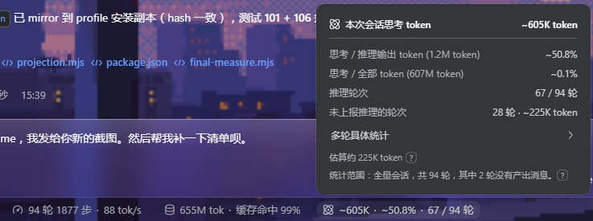
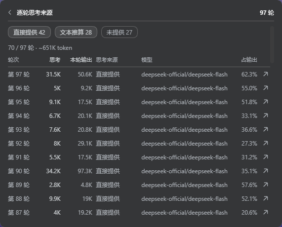

# dsh-thinking-token-stat

> **English** | [中文](./README_zh.md)

[](https://github.com/awesome-dsh-plugin/awesome-dsh-plugin)
[](https://github.com/deepseek-ai/deepseek-harness)
[](./LICENSE)
[](https://www.npmjs.com/package/dsh-thinking-token-stat)
[](https://www.npmjs.com/package/dsh-thinking-token-stat)
[](https://github.com/Six6stRINgs/dsh-thinking-token-stat)
[](https://github.com/Six6stRINgs/dsh-thinking-token-stat/)

A lightweight thinking/reasoning token statistics plugin for DeepSeek Harness (DSH). Displays whole-session thinking token totals and ratios right in the composer dock, with official frosted-glass detail popovers and turn-by-turn model breakdowns.





## Features

### 1. Composer Dock Readout
Always visible in the status line below the message input box:
```
💭 37.2K · 70.7% · 4 / 6 turns
```
- **Total Thinking Tokens**: The cumulative count of reasoning tokens across the entire conversation.
- **Thinking / Output Ratio**: The proportion of thinking tokens relative to total reasoning output.
- **Reasoning Turns**: Active thinking turns out of total turns (displayed when non-thinking turns exist).

### 2. Session Overview Panel
Clicking the dock readout opens the overview panel, fully styled according to DSH official popover design and frosted-glass vibrancy:
- **Thinking / Reasoning Output**: Share of thinking tokens within reasoning-capable turns.
- **Thinking / All Tokens**: Share of thinking tokens out of total billed session tokens (input + output + cache).
- **Turn Counts**: Total turns vs. active reasoning turns.
- **Estimate Transparency**: When a model does not report token counts, the estimated turn count and token volume are clearly broken out with a `?` explaining the formula.
- **Scope Audit**: Statically proves what the figures cover (empty turns, fork-excluded prefixes, etc.).

### 3. Turn-by-Turn Breakdown
Click "Detailed turn statistics" in the overview to open the per-turn table (newest turns first):
- **Turn Number & Thinking Tokens**: Per-turn count (estimated figures prefixed with `~` and highlighted in business accent).
- **Turn Total Output**: Total tokens written in that turn.
- **Thinking Source**: Indicates whether the count was provider-reported, text-estimated, or mixed.
- **Model Attribution**: Exact Provider and Model names (e.g. `deepseek-official/deepseek-reasoner`), tracking retries and model switches accurately.
- **Output Share**: Percentage of the turn's output spent on reasoning.
- **Quick Filtering**: Filter by Reported, Estimated, or None (collapsed by default).
- **Jump to Reply**: Jump button on each row pages DSH history and navigates straight to the message.

---

## Token Counting & Estimation

Not all model providers report reasoning tokens via API usage metadata. To ensure accurate and meaningful statistics in every environment, the plugin employs a transparent hybrid strategy:

| Provider Response | Method | Display |
| :--- | :--- | :--- |
| **Reports reasoning tokens** | Uses exact provider count | Stated exactly; marked as `Reported` |
| **Provides reasoning text only** | Multi-script density estimation | Prefixed with `~` (e.g. `~5.1K`); marked as `Estimated` |
| **Provides neither** | Counted as non-thinking | Collapsed by default in the turn list |

### Multi-Script Character Density Rules

Estimating tokens using a flat 4 characters/token English heuristic undercounts dense scripts by 2–4×. This plugin segments text by script family:

| Script | Characters / Token | Rationale |
| :--- | :---: | :--- |
| **CJK (Chinese, Japanese kana, Korean Hangul, fullwidth)** | **1** | Measured tokenizers range ~0.6–1.7 tokens/char (DeepSeek/Qwen tokenizers sit at 0.6–0.8). 1 char/token is conservative and avoids overestimating. |
| **Cyrillic, Greek, Arabic, Hebrew, Indic, Thai, etc.** | **2.5** | Typically measured at 2–3 characters per token. |
| **Latin, digits, punctuation, whitespace** | **4** | Standard empirical benchmark for English and Western prose. |

All estimated numbers are explicitly prefixed with `~` and never misrepresented as exact provider telemetry.

---

## Architecture & Performance

- **Durable Session Projection**:
  - Folded incrementally on the host Node process as an event-driven Reducer over `assistant/message` settlements.
  - Persisted as a session projection checkpoint (`<root>/session_projcache/sessions/<id>.json`), requiring only a few KB per session.
  - Covers the complete session event log, immune to client-side window paging, virtual scrolling, or compaction.
- **Zero Frontend Overhead**:
  - The browser half simply reads a single projection value via `useProjection("thinkingStats")`. No message parsing, no background API requests, and no `localStorage` caching.
- **Native DSH Alignment**:
  - Strictly adheres to DSH `stat-dialog.module.css` specs, incorporating `var(--dsw-menu-backdrop-filter)` (40px blur) and `var(--dsw-radius-lg)` corner radius.
  - Automatically adapts to Light and Dark themes.
  - Matches the client UI language automatically (Chinese & English).

---

## Installation

### Method 1: DSH Plugin Market (Recommended)
Open the **Market** in DSH Desktop or Web GUI, search for `dsh-thinking-token-stat`, and click Install.

### Method 2: Command Line
Run in your terminal:
```sh
dsh plugin add dsh-thinking-token-stat
```
*Or install the latest development branch from GitHub:*
```sh
dsh plugin add github:Six6stRINgs/dsh-thinking-token-stat
```

After installation, refresh your browser or desktop window (`Ctrl+R`). The indicator appears automatically once the model begins thinking.

---

## Development

The plugin consists of two self-contained modules:
- `lib/index.js`: Host half; registers the `thinkingStats` session projection and fold logic.
- `lib/client.js`: Client half; injects the readout, popover, and table into the composer dock slot.

Run tests:
```sh
npm test
```
(Executes `test/projection.mjs` for host fold semantics and `test/harness.mjs` for client UI rendering and degradation paths).

---

## License

[MIT](./LICENSE)
